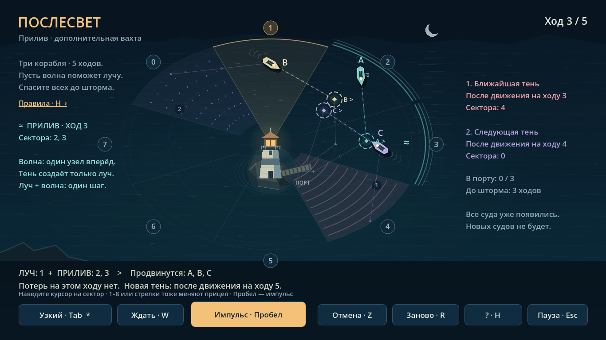

# Послесвет

Небольшая пошаговая игра о маяке, кораблях и последствиях собственного света.
Проведите суда домой: каждый импульс помогает сейчас, но через два хода возвращается опасной тенью.

[Играть в браузере](https://moyisey.github.io/poslesvet/) · [Windows x64](https://github.com/MOYISEY/poslesvet/releases/latest)



## Версия 0.2.0

- Простое обучение, четыре обычные ночи и дополнительная вахта «Прилив».
- В новой вахте на ходу 3 волна двигает суда в секторах 2 и 3. Можно совместить её с лучом, направленным в другой сектор. Волна не создаёт тень; совпадение волны и луча даёт один шаг.
- Предпросмотр перемещений и опасности, неограниченная отмена ходов.
- Плавное движение и покачивание судов, волны, импульсы света и синтезированный звук. Решения остаются пошаговыми, таймера нет.
- Автоматическое сохранение текущего хода, истории отмены и пройденных вахт. При следующем запуске нажмите «Продолжить».

Прилив открывается после обучения: **Пауза → Выбор вахты → Прилив**.

## Запуск и управление

Windows: распакуйте архив релиза и запустите **Afterlight.exe**. **Afterlight.pck** должен лежать рядом. Устанавливать Godot или Python игроку не нужно; Windows-игра работает локально без игрового сервера.

Мышь, стрелки или клавиши 1–8 выбирают сектор. **Tab** меняет ширину луча, **W** выбирает ожидание. **Пробел / Enter** подтверждает ход, **Z** отменяет его, **R** начинает вахту заново. **H** — правила, **Esc** — пауза, **F11** — полный экран.

Браузерная версия требует WebGL 2.0 и WebAssembly. Сохранения хранятся в данных этого сайта; очистка данных сайта или приватный режим могут удалить их. Сохранения Windows и браузера независимы.

## Разработка и проверки

Откройте `project.godot` в Godot **4.7.2**, установите официальные export templates той же версии. Рендерер — Compatibility. Web-экспорт однопоточный.

```sh
python -m unittest discover -s core -p 'test_*.py'
godot --headless --path . --script res://tests/verify_core.gd
godot --headless --path . --script res://tests/verify_session.gd -- --qa
godot --headless --path . --script res://tests/verify_progress.gd -- --qa
```

Проверены 22 теста Python, 1700 переходов между Python и GDScript, 14 проверок контроллера и 31 проверка сохранений. Экспортированный Windows EXE прошёл 111 проверок ввода и интерфейса; web-версия — 11 проверок в Chromium, включая настоящее обновление страницы и продолжение из IndexedDB.

Windows-тесты вводят события через API движка; браузерные тесты используют Playwright. Это автоматизированные проверки, не человеческий плейтест. Длительность и субъективная сложность прохождения ещё не измерены.

CI повторяет тесты, собирает web-демо из конкретного коммита и развёртывает его через GitHub Pages. Сценарии и чистая модель находятся в `core/`, правила движка — в `scripts/rules.gd`.

Лицензии движка и его компонентов: [Godot](LICENSE-Godot.txt), [зависимости](THIRD-PARTY-NOTICES.txt). Графика и звук игры создаются программно.
